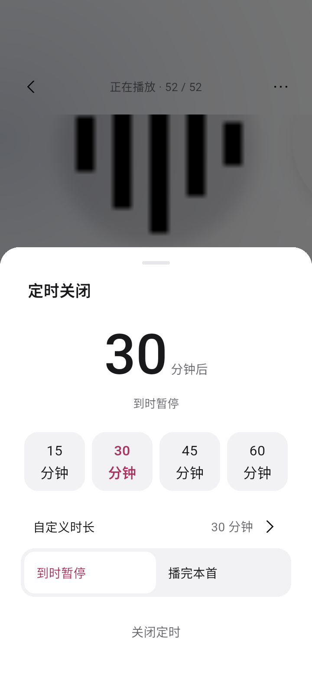
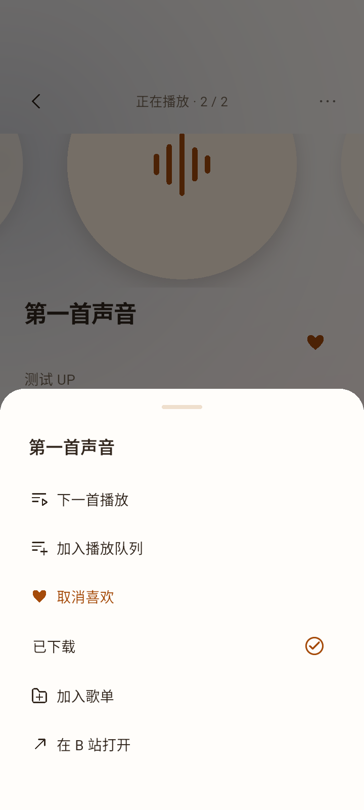

[](https://github.com/boyl/tingyu/releases) [](https://github.com/boyl/tingyu/stargazers) [](https://github.com/boyl/tingyu/releases/latest) [](https://github.com/boyl/tingyu/blob/HEAD/LICENSE)

# tingyu · 本地优先音乐播放器

正式工程，与 `../music-player-prototype` 的 React 交互原型相互独立。目标为 Windows、macOS 和 Android，本地优先，无自建后端。主题为哔哩粉、日出橙、月影蓝、夜间暗，默认哔哩粉；未发布阶段不做旧主题兼容映射。

## 当前阶段

当前发布为 **0.1.21+22**，Android 只提供 arm64-v8a 开发签名包。歌曲详情改为全封面唱片，下载和定时按第22版确认稿使用。Mac 新设计和桌面打包暂停。

0.1.21 把下载收进歌曲更多菜单，顶部轮播播放模式和序号，歌词按实际文字换行，定时使用大号时长，首页增加整库操作，登录二维码改为把同一次会话交给系统浏览器。模拟器无声用本机运行时处理，不能写成播放器修复，详见 [本轮 Spec](docs/specs/playback-experience-v18.md) 和 [0.1.21 验收](docs/ACCEPTANCE-2026-10-19-021.md)。

已有实现还包括：四种播放模式（含播完暂停）、0.5–2× 倍速、全局歌词显示与独立歌词页、逐字/翻译/罗马音、队列拖拽、底栏透明度、唯一账号入口，以及 tingyu 与包版本启动画面。工程通过和真机全验以版本验收记录为准。

### 我要下载哪个版本？

| 设备／场景 | 应下载的文件 | 说明 |
|---|---|---|
| 支持 arm64-v8a 的 Android 设备 | [tingyu-0.1.21-android-arm64-v8a-release.apk](https://github.com/boyl/tingyu/releases/download/v0.1.21/tingyu-0.1.21-android-arm64-v8a-release.apk) | 本次唯一安装包。不提供其他架构或桌面包。 |

只构建及提供 arm64-v8a，不提供 armeabi-v7a、x86_64 或通用 Release。当前为开发/debug 签名，同签名覆盖升级保留数据，不要求卸载或清空数据。SHA-256：`a195f15614b97649cb5a907b5031f60852ef5359753f2f2f190f6cb3545e943a`。

## 本版验证与运行截图

离线测试、原生导航、交互、导出、滚动专项和匿名 B 站真实音频下载及断网回放的结果见 [0.1.21 验收记录](docs/ACCEPTANCE-2026-10-19-021.md)。开发签名包不表示真机全验。

截图为同版界面的测试夹具，不使用真实曲库。真实账号授权、物理设备听感及厂商后台仍待验。

| 全封面详情 | 定时关闭 | 下载在更多里 |
|---|---|---|
|  |  |  |

## 工具链与运行

本机 Flutter 3.47.7 / Dart 3.13.5 位于工作区专用目录，不修改系统 PATH：

```sh
cd /Users/dfq/works/repo/lw/tingyu
sh tool/flutterw.sh pub get
sh tool/flutterw.sh analyze
sh tool/flutterw.sh test
sh tool/flutterw.sh run -d macos
```

在其他机器使用自己的 Flutter stable，并执行相同的 `flutter` 命令。依赖版本记录在 `pubspec.lock`。

- macOS：需要完整 Xcode，完成首次初始化并选为 active developer directory；CocoaPods / Flutter Swift Package Manager 配置以 `flutter doctor -v` 为准。本机已安装 Xcode 27.1，但尚未完成许可确认，构建被 Xcode 拦截；先打开 Xcode 完成首次初始化。
- Android：需要 JDK 17、Android SDK 及已接受的 SDK licenses；执行 `flutter run -d <设备ID>` 或 `flutter build apk --debug`。本机已在工作区安装 JDK 17 和 Android SDK 36，使用 `sh tool/flutterw.sh build apk --debug` 自动设置本地环境；未修改系统 PATH。
- Windows：在 Windows 上安装 Flutter 和 Visual Studio 的 Desktop development with C++ 工作负载，再执行 `flutter run -d windows` 或 `flutter build windows`。本机不能交叉验收 Windows。

初次打包是开发构建；Android 模板使用调试签名。正式签名、公证、安装程序和自动更新不在当前验证范围内。

## 长期维护文档

- [已有功能与行为契约](docs/FEATURES.md)：入口、状态、数据与能力边界。
- [验收标准](docs/ACCEPTANCE.md)：功能与 V01–V09 风格门禁、自动/原生/人工证据。
- [界面规范](docs/UI.md)：当前已确认视觉与历史演进。
- [红绿重构流程](docs/REFACTORING.md)：基线、Red → Green → Refactor、回归范围与记录模板。
- [图标资源规范](docs/ICONS.md)：优先复用、状态配色、使用登记和校验。
- [本轮开发计划](docs/PLAN-2026-10-19.md)：需求、阶段、回归与交付边界。
- [发布准则](docs/RELEASE.md)：只构建和发布 arm64-v8a、同源签名校验和远端资产核对；新增/变更功能必须在同次发布同步更新相关文档。

## 架构和状态

- `lib/models` 定义曲目、分 P、歌单、下载任务与业务失败。稳定曲目标识为 `bvid:cid`；搜索的临时 CID 在详情解析后更新所有引用。
- `lib/controllers` 协调业务状态和播放。Riverpod 管理控制器生命周期，go_router 管理页面。
- `lib/services` 隔离 B 站接口、系统安全凭据、Drift/SQLite、歌词提供方、下载管理和平台播放器。
- `lib/ui` 用同一套语义主题变量渲染响应式界面，960px 切换桌面/紧凑布局。Pressable 统一触控反馈、键盘和焦点。

Android/macOS 使用 just_audio；Windows 使用 just_audio_media_kit。系统媒体控制使用 audio_service 和 Windows 适配包；采用原生 HTTP 请求头，不启动额外音频代理服务器。

本地目录通过 path_provider 获取。SQLite 保存曲目和整理状态，下载文件写到应用数据目录。Cookie 只进入系统安全存储，不写 SQLite、日志或音频 CDN 请求头。网络请求为 HTTPS；Android 本地回环例外配置仅限 localhost。

## 使用与恢复行为

1. 未登录可从搜索页粘贴 BV 号开始；关键词搜索可能受 B 站验证/风控限制，界面会提示而不是显示假空结果。
2. 播放前获取有效流地址；本地完整下载优先。运行期播放错误最多触发一次重新解析并恢复进度，失败后给出重试入口。
3. 下载排队串行执行，临时文件以 `.part` 写入，长度检查通过后才改名为音频文件。未知总长度显示不确定进度。取消/失败不会提供离线文件。
4. 中断任务重试时重新下载，避免对不同临时 URL 盲目拼接；**目前不实现 HTTP Range 断点续传**。已下载音频附带曲目信息、封面和已匹配歌词。
5. 重启检查下载文件是否存在且长度一致；缺失/损坏标记失败。歌单、喜欢、队列和进度持久化，恢复后暂停。删除下载保留歌单和喜欢。
6. Android 下载只在应用进程存活期间运行，不能保证系统结束进程后仍继续；后台播放通过媒体服务配置。
7. 歌词源没有逐字/翻译/罗马音数据时不伪造，保留逐句或纯文本显示；跨设备同步、车载、复杂音效、音量均衡和自动更新暂未实现。

## 验证与真实网络探测

```sh
sh tool/flutterw.sh test --reporter expanded
sh tool/flutterw.sh test --dart-define=RUN_LIVE_PROBE=true --reporter expanded
```

普通测试不访问 B 站、不读取真实登录凭据。覆盖 WBI 标准参考向量、分 P、音质选择、Cookie/CDN 隔离、搜索验证挑战、LRC、SQLite 重开、下载缺失/截断/原子完成/删除保留数据，以及四主题的文字对比度、48px 目标和四种尺寸的基础按钮操作。

历史主机探测报告在 `tool/live-probe.json`。当前可用 `python3 tool/run_acceptance.py --device emulator-5558 --live` 在隔离 Android 模拟器运行匿名公共 BV 搜索、真实音频解码、下载和强制断网回放；不保存签名 URL 或凭据。这仍不证明听感、物理设备后台服务或真实账号流程已验收。

尚需在目标环境验收：地址过期的真实 CDN 恢复、听感；Android 锁屏/通知栏、来电和拔耳机；macOS 和 Windows 系统媒体键与托盘；三端安全存储；真实扫码登录与收藏夹；完整页面小屏/大字体和屏幕阅读器体验。网络探测结果受检查时的接口状态影响。

可参考的上游：[just_audio](https://pub.dev/packages/just_audio)、[just_audio_media_kit](https://pub.dev/packages/just_audio_media_kit)、[audio_service](https://pub.dev/packages/audio_service)、[audio_service_win](https://pub.dev/packages/audio_service_win)、[Drift](https://drift.simonbinder.eu/)、[flutter_secure_storage](https://pub.dev/packages/flutter_secure_storage)。

## 本轮交付

- 0.1.11 视觉更新开发版：按已确认交互稿重做搜索、设置、封面歌单、迷你播放器与导航；音乐库手机顶部为左侧头像、右侧“随心听”，搜索和新建歌单各保留对应内容区的唯一入口。新增 D 哔哩粉作为首次启动/未设置主题时的默认值，已有主题保留；登录恢复后异步刷新 B 站头像。队列使用动态音柱与暂停图标。验收状态见 [本轮视觉验收](docs/ACCEPTANCE-2026-10-18-VISUAL.md)，并包含在 0.1.12 发布中。

- 0.1.10 队列统一动态/静态音柱，长列表增加按需出现的回顶入口，下载任务与已下载分页、已下载按完成时间倒序，并明确外部 B 站入口。已登录时搜索空态不再提示导入收藏夹。见 [音柱与回顶验收](docs/ACCEPTANCE-2026-10-17-QUEUE-INDICATOR.md)。
- 0.1.9 长列表按需构建、进度刷新隔离、向当前歌单本地多选/在线定向添加、分类现场恢复和轻量歌单过渡，见 [滚动及选歌验收](docs/ACCEPTANCE-2026-10-17-SCROLL.md)。
- 0.1.8 封面持久复用、下载歌词补全、B 站 CC/AI 字幕与已有内嵌歌词读取，支持系统选择位置导出带封面、元数据、内嵌 LRC 的 M4A；不转码、不修改原下载。覆盖边界见 [离线与导出验收](docs/ACCEPTANCE-2026-10-17-OFFLINE-EXPORT.md)。
- 0.1.7 队列当前标记/定位、本地列表搜索、主题首次切换稳定性、四字歌单编辑与紧凑简介输入，见 [交互验收](docs/ACCEPTANCE-2026-10-17-INTERACTIONS.md)。

- 0.1.6 修复列表点歌没有建立完整队列、随机重复与上一首错误；增加随机周期/历史恢复、优先下一首和异步切歌稳定性，见 [播放专项验收](docs/ACCEPTANCE-2026-10-16-PLAYBACK.md)。旧手工队列保留，从曲库重新点歌才采用当前列表范围。

- Android 0.1.21 只构建、发布 arm64-v8a 安装包，附在 [GitHub Release](https://github.com/boyl/tingyu/releases/tag/v0.1.21)。不再附带 x86_64 与 armeabi-v7a。仍为开发签名，不是应用商店上架包；真机听感、真实账号与桌面验收未完成。上一公开发布为 [0.1.20](https://github.com/boyl/tingyu/releases/tag/v0.1.20)。
- 本轮改为独立设置页，账号与收藏夹收在顶部卡片；主题、音质、下载管理和关于集中展示，移除抽屉与重复入口。验收见 [0.1.5 设置页](docs/ACCEPTANCE-2026-10-16-SETTINGS.md)。此前曲库/歌单图标、排序与批量整理、直接模式切换及下载反馈见 [0.1.4 验收](docs/ACCEPTANCE-2026-10-16-MINIMAL.md)；交互稳定性基础见 [0.1.3 交互验收](docs/ACCEPTANCE-2026-10-16-INTERACTIONS.md)：覆盖全部共享页面、播放模式、队列、歌单、下载故障恢复、登录状态和歌词竞态。真实公共 BV 的 Android 解码与离线回放单独记录，真实账号与物理设备仍待验。
- 当前拆分包大小、SHA-256 和 ABI 记录于 `tool/release-apks.json`；旧调试包的历史记录在 `tool/verification.json`。
- macOS 构建因 Xcode 许可尚未确认而被拦截；Windows 尚未在 Windows 主机构建。
- 新增工作流仅支持手动触发，尚未运行。工程仓库为公开的 `boyl/tingyu`；构建产物不入库，Android 安装包只附在 Release。
- 浏览器地址仍是先前 React 原型。正式 Flutter 工程需运行原生应用或安装 APK 才能体验真实接口。


## 本地验收门禁

验收标准、状态矩阵与交付顺序见 [docs/ACCEPTANCE.md](docs/ACCEPTANCE.md)。

```sh
python3 tool/run_acceptance.py
python3 tool/run_acceptance.py --device emulator-5558 --live
```

日志与带源码指纹的结果保存在 `artifacts/acceptance/`。第二条会运行真实 Android 原生应用，验证连续切换、搜索输入保留、滚动位置和主题切换。它不代表全功能或真机验收完成。未执行项不算通过。

紧凑布局使用无填充的图标与文字导航，go_router 的持久分支保存各 tab 状态；切换无整页转场并收起键盘。Android 使用边到边背景，系统状态栏和导航栏保持可见。桌面保留系统窗口行为。


本机启动可见模拟器：`sh tool/android_emulator.sh`（Apple Silicon、本工作区 SDK）。开发运行使用独立回归设备 `sh tool/flutterw.sh run -d emulator-5558`；人工验收设备 5556 仅使用同签名 Release 覆盖更新。状态栏时间、信号和电量保持可见。

Android 账号窗口采用大尺寸底部面板，收藏夹列表独立滚动，先选择再导入；导入入口固定在底部。桌面账号窗口使用限制宽高的对话框。专项验收结果见 `docs/ACCEPTANCE-2026-10-16.md`。

自动测试请使用 `TINGYU_EMULATOR_TEST=1 TINGYU_EMULATOR_HEADLESS=1 sh tool/android_emulator.sh` 启动独立的 `emulator-5558`。人工验收设备 `emulator-5556` 保留真实登录和歌单，不允许测试脚本降级安装或注入测试数据。播放器顶部返回导航固定显示，不随封面与歌词滚动。

- 0.1.12 视觉修订：继续收听大幅封面、可露出下一张的横向歌单与外观预览、连续下载区域、统一线性图标、静态/动态音柱及队列拖动。四主题覆盖页面、卡片、弹层与播放器；详情见 [修订验收](docs/ACCEPTANCE-2026-10-18-REVISION.md)。

- 0.1.17 使用已确认的柔角折带图标：纯白细线、透明底，适配 legacy、自适应与 monochrome。歌曲详情增加两侧唱片侧露与左右滑动，随机/循环模式及下一首优先复用原有切歌逻辑；设置页保留原有样式，取消试验性的磨玻璃设置。仅发布 arm64-v8a，Mac 与 Windows 图标资源未改。
- 0.1.15 更换应用图标；播放页歌词停在当前句并完整显示在进度条上方，封面改为播放时转动的唱片。音乐库搜索框与「歌曲」标题放在一起，下载页切换「已下载 / 下载任务」时搜索框不再上下移动。模拟器人工确认通过。
- 0.1.14 统一四主题玻璃播放栏与导航、列表和弹层层次；封面放大并统一小圆角，保留横向侧露。区分下一首、入队、加入歌单等图标，移除与关闭不再使用 X；喜欢显示实心红心，Android 系统栏常显。验收见 [玻璃与系统栏](docs/ACCEPTANCE-2026-10-18-GLASS.md) 和 [图标与封面](docs/ACCEPTANCE-2026-10-18-ICONS-COVERS.md)。
