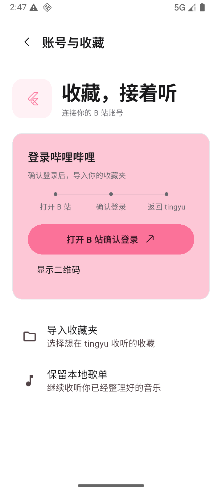
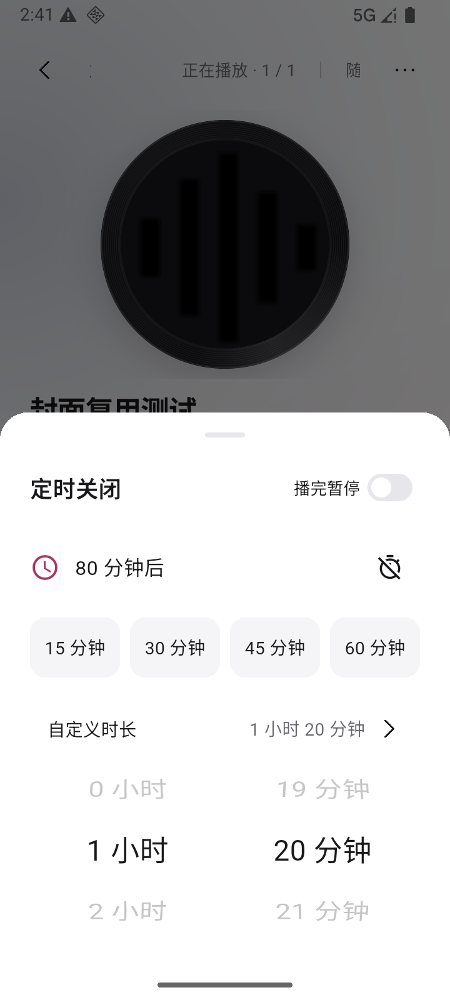

# tingyu

一款本地优先的 B 站音乐播放器。把喜欢的声音整理成歌单，随时收听。

[下载](#下载与安装) · [界面](#界面预览) · [功能](#主要功能) · [常见问题](#常见问题) · [开发](docs/DEVELOPMENT.md)

## 界面预览

  
  
  

截图展示已发布的 0.1.23 界面，使用示例曲目。

## 下载与安装

当前发布版本为 **0.1.23**。前往 [Releases](https://github.com/boyl/tingyu/releases/latest) 查看更新说明。

| 平台 | 下载 |
|---|---|
| Android · arm64-v8a | [下载 APK](https://github.com/boyl/tingyu/releases/download/v0.1.23/tingyu-0.1.23-android-arm64-v8a-release.apk) |
| macOS / Windows | 暂无安装包 |

Android 目前仅提供 arm64-v8a 包，使用开发签名。同签名升级可直接覆盖安装，保留歌单与下载，无需卸载或清空数据。

校验安装包

文件：`tingyu-0.1.23-android-arm64-v8a-release.apk`

SHA-256：`1d4284a5ec55f449656e78ae7dde07daeadf32902a20ab39307f269d6d720f00`

## 主要功能

- **搜索与收听**：搜索歌曲、粘贴 BV 号或 B 站链接，支持分 P 和后台播放。
- **整理音乐**：本地歌单、喜欢、播放队列、排序与多选；支持打开 B 站确认登录与二维码备用；登录后可导入收藏夹。
- **离线播放**：下载音频及可用的封面、歌词，支持导出 M4A。
- **歌词**：同步逐句／逐字歌词、翻译与罗马音，可手动匹配、编辑和调整偏移；以歌词源实际提供的内容为准。
- **播放控制**：循环、随机、播完暂停、倍速、音量与定时关闭；自定义时长滚轮带刻度反馈。
- **外观**：哔哩粉、日出橙、月影蓝与夜间暗四种主题。

## 常见问题

**需要登录吗？** 公开 BV 内容可先尝试匿名播放；收藏夹等账号内容需要登录。搜索、播放与授权也受 B 站接口和风控影响。

**数据保存在哪里？** 歌单、喜欢和下载保存在本机，登录凭据使用系统安全存储。当前不提供跨设备同步。

**为什么下载没有继续？** 应用进程被系统结束后，下载不会继续。中断任务可重试，目前不支持 HTTP Range 断点续传。

**哪些平台可以使用？** 当前仅发布 Android arm64-v8a 安装包。桌面端仍在开发，模拟器测试不能替代物理设备验收。

## 开发与文档

项目使用 Flutter / Dart，无自建后端。开发环境、架构与检查命令见[开发指南](docs/DEVELOPMENT.md)。

[功能清单](docs/FEATURES.md) · [界面规范](docs/UI.md) · [验收标准](docs/ACCEPTANCE.md) · [发布准则](docs/RELEASE.md) · [版本记录](https://github.com/boyl/tingyu/releases)

0.1.23 的变更与验证边界见[验收记录](docs/ACCEPTANCE-2026-10-21-023.md)。B 站客户端接管已验证，真实账号授权与重启登录保持仍待验。

## 许可

项目采用 [MIT License](LICENSE)。第三方组件和资源遵循各自许可。
