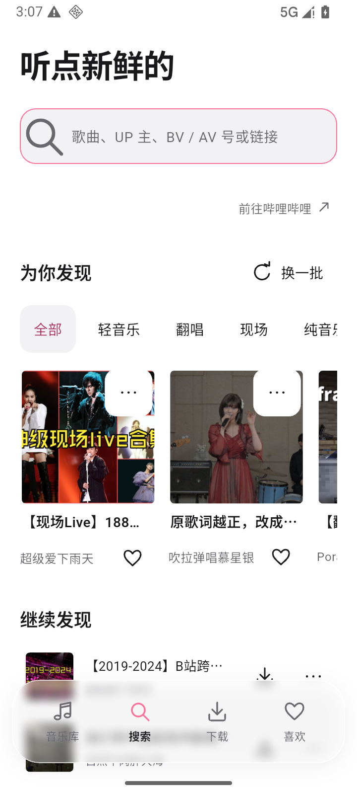
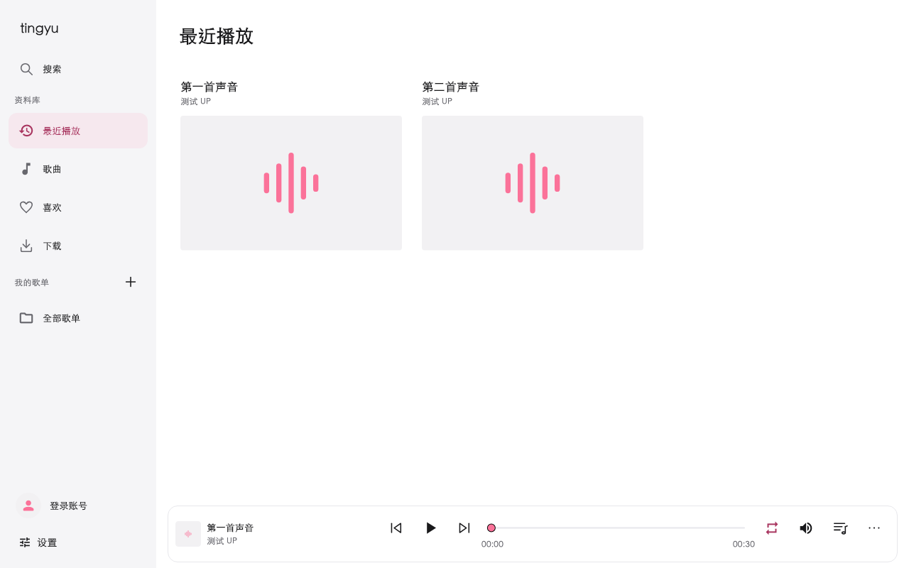
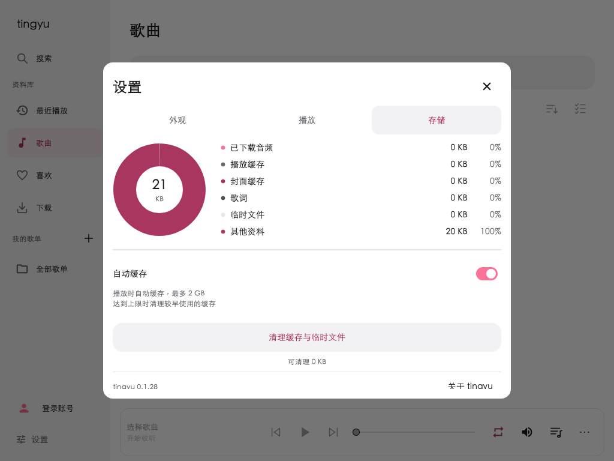

# tingyu

一款本地优先的 B 站音乐播放器。把喜欢的声音整理成歌单，随时收听。

[下载](#下载与安装) · [界面](#界面预览) · [功能](#主要功能) · [常见问题](#常见问题) · [开发](docs/DEVELOPMENT.md)

## 界面预览

### Android 手机

  
  
  

### macOS

Windows 与 Mac 沿用同一桌面设计，不重复展示截图。Android 搜索截图来自 0.1.33 Release，其他 Android 截图来自 0.1.23；Mac 搜索截图为 0.1.33 真实匿名推荐内容的 Flutter 组件运行截图，其他 Mac 截图为 0.1.27–0.1.28 组件夹具，验证范围见[桌面开发说明](docs/DESKTOP.md)。

## 下载与安装

Android、Mac 与 Windows 最新版本均为 **0.1.33**。前往 [Releases](https://github.com/boyl/tingyu/releases/latest) 查看更新说明。

| 平台 | 下载 |
|---|---|
| Android · arm64-v8a · 0.1.33 | [下载 APK](https://github.com/boyl/tingyu/releases/download/v0.1.33/tingyu-0.1.33-android-arm64-v8a-release.apk) |
| macOS 12+ · 0.1.33 · Apple Silicon / Intel（Intel 真机待验） | [下载开发版 DMG](https://github.com/boyl/tingyu/releases/download/v0.1.33/tingyu-0.1.33-macos-release.dmg) |
| Windows 10/11 · x64 · 0.1.33 | [下载安装程序 EXE](https://github.com/boyl/tingyu/releases/download/v0.1.33/tingyu-0.1.33-windows-x64-setup.exe) |

三端 0.1.33 优化兴趣推荐与连续加载，加入本地收听反馈、“不感兴趣”及撤销；探索标签支持单行横滑。

Android 目前仅提供 arm64-v8a 包，使用开发签名。同签名升级可直接覆盖安装，保留歌单与下载，无需卸载或清空数据。

Android 与 Mac 0.1.33 校验与验证范围见[发布记录](docs/ACCEPTANCE-2026-11-11-033.md)；Windows 校验与验证范围见[Windows 发布记录](docs/ACCEPTANCE-2026-11-11-WINDOWS-033.md)。Mac 使用 ad-hoc 签名，未经过 Apple 公证，系统可能阻止直接打开；本版不等同于商店正式发行。

Windows 运行安装 EXE，按向导选择目录并安装；支持开始菜单、可选桌面快捷方式和系统卸载入口。升级前从托盘退出旧版，卸载保留歌单与下载。Windows 0.1.33 同步新版推荐与输入法空格修复，保留封面及托盘修复；安装包未进行商业代码签名，真实输入法选词和本轮完整人工验收边界见[Windows 发布记录](docs/ACCEPTANCE-2026-11-11-WINDOWS-033.md)。

## 主要功能

- **搜索与收听**：搜索歌曲、粘贴 BV 号或 B 站链接，支持分 P 和后台播放；三端搜索页提供精选横滑、下滑自动加载的推荐列表、换一批和单行横滑探索标签，结合喜欢与近期收听轮换兴趣；支持“不感兴趣”、撤销和清除本地推荐偏好，保留「前往哔哩哔哩」。
- **整理音乐**：带封面的全部歌单列表、本地歌单、喜欢、播放队列、排序与多选；支持打开 B 站确认登录与二维码备用；登录后可导入收藏夹。
- **离线播放**：下载音频及可用的封面、歌词，支持导出 M4A。
- **自动缓存**：默认开启，最多 2 GB，优先淘汰较早使用的缓存；关闭后保留已有缓存。下载复用匹配音质的完整缓存或同一活动传输，缓存与下载分开保存。
- **歌词**：同步逐句／逐字歌词、翻译与罗马音，可手动匹配、编辑和调整偏移；以歌词源实际提供的内容为准。
- **播放控制**：循环、随机、播完暂停、倍速、音量与定时关闭；桌面播放模式按钮依次切换列表循环、单曲循环、随机播放、播完暂停。自定义时长滚轮带刻度反馈；音量和定时结束方式跨重启保留。
- **外观**：哔哩粉、日出橙、月影蓝与夜间暗四种主题。

## 常见问题

**需要登录吗？** 公开 BV 内容可先尝试匿名播放；收藏夹等账号内容需要登录。搜索、播放与授权也受 B 站接口和风控影响。

**数据保存在哪里？** 歌单、喜欢和下载保存在本机，登录凭据使用系统安全存储。当前不提供跨设备同步。

**为什么下载没有继续？** 应用进程被系统结束后，下载不会继续。中断任务可重试，目前不支持 HTTP Range 断点续传。

**哪些平台可以使用？** 提供 Android arm64-v8a 安装包、Mac 开发版和 Windows x64 安装版。Windows x64 开发版与两端在同一 Release 下载；验证边界见[Windows 规范](docs/specs/windows-desktop-parity.md)。模拟器测试不能替代物理设备验收。

## 开发与文档

项目使用 Flutter / Dart，无自建后端。开发环境、架构与检查命令见[开发指南](docs/DEVELOPMENT.md)。

[功能清单](docs/FEATURES.md) · [界面规范](docs/UI.md) · [验收标准](docs/ACCEPTANCE.md) · [发布准则](docs/RELEASE.md) · [版本记录](https://github.com/boyl/tingyu/releases)

0.1.28 的变更与验证边界见[验收记录](docs/ACCEPTANCE-2026-10-25-028.md)。真实账号授权与重启登录保持仍待验。

## 许可

项目采用 [MIT License](LICENSE)。第三方组件和资源遵循各自许可。
