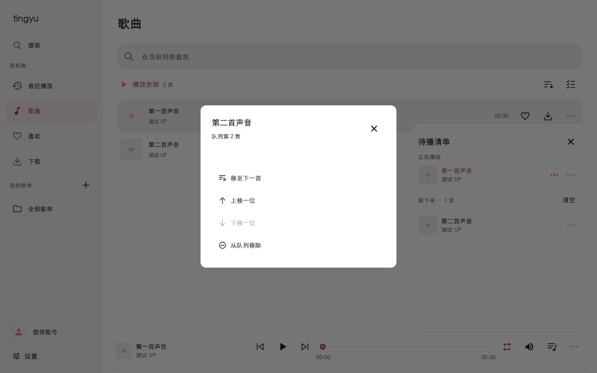
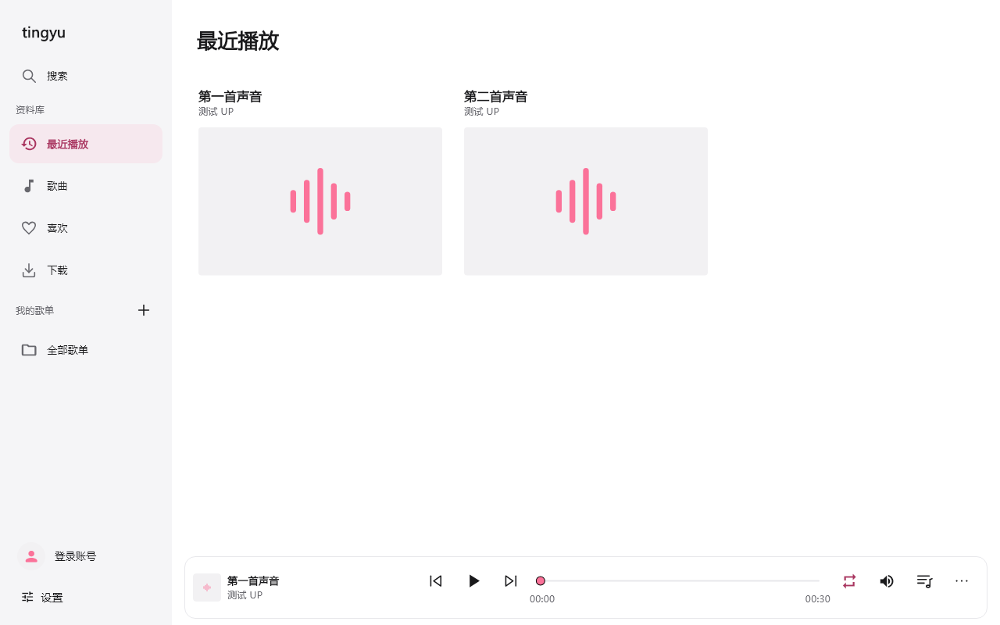
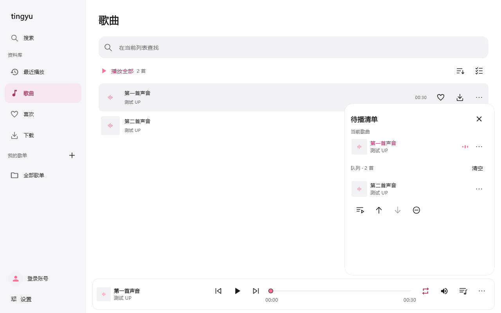

# tingyu

一款本地优先的 B 站音乐播放器。把喜欢的声音整理成歌单，随时收听。

[下载](#下载与安装) · [界面](#界面预览) · [功能](#主要功能) · [常见问题](#常见问题) · [开发](docs/DEVELOPMENT.md)

## 界面预览

### Android 手机

  
  
  

### macOS

### Windows

Windows 截图为本机字体的 Flutter 组件夹具，不是原生窗口截图。Android 截图来自 0.1.23；Mac 截图为 0.1.27–0.1.28 的 Flutter 组件夹具，验证范围见[桌面开发说明](docs/DESKTOP.md)。

## 下载与安装

当前发布版本为 **0.1.28**。前往 [Releases](https://github.com/boyl/tingyu/releases/latest) 查看更新说明。

| 平台 | 下载 |
|---|---|
| Android · arm64-v8a | [下载 APK](https://github.com/boyl/tingyu/releases/download/v0.1.28/tingyu-0.1.28-android-arm64-v8a-release.apk) |
| macOS 12+ · Apple Silicon / Intel（Intel 真机待验） | [下载开发版 DMG](https://github.com/boyl/tingyu/releases/download/v0.1.28/tingyu-0.1.28-macos-release.dmg) |
| Windows 10/11 · x64 | [下载开发版 ZIP](https://github.com/boyl/tingyu/releases/download/v0.1.28/tingyu-0.1.28-windows-x64-release.zip) |

Android 目前仅提供 arm64-v8a 包，使用开发签名。同签名升级可直接覆盖安装，保留歌单与下载，无需卸载或清空数据。

校验值见 [0.1.28 发布记录](docs/ACCEPTANCE-2026-10-25-028.md)。Mac 使用 ad-hoc 签名，未经过 Apple 公证，系统可能阻止直接打开；本版不等同于商店正式发行。

Windows 解压完整文件夹后运行 tingyu.exe；升级前从托盘退出旧版，不要只复制 EXE。三个平台集中在 v0.1.28 Release；Windows 为后续补充构建，源码与验证边界见[Windows 发布记录](docs/ACCEPTANCE-2026-10-26-WINDOWS.md)。Mac/Android 原附件保持不变，Windows 修复不表示两端旧包已包含同样变更。

## 主要功能

- **搜索与收听**：搜索歌曲、粘贴 BV 号或 B 站链接，支持分 P 和后台播放。
- **整理音乐**：带封面的全部歌单列表、本地歌单、喜欢、播放队列、排序与多选；支持打开 B 站确认登录与二维码备用；登录后可导入收藏夹。
- **离线播放**：下载音频及可用的封面、歌词，支持导出 M4A。
- **自动缓存**：默认开启，最多 2 GB，优先淘汰较早使用的缓存；关闭后保留已有缓存。下载复用匹配音质的完整缓存或同一活动传输，缓存与下载分开保存。
- **歌词**：同步逐句／逐字歌词、翻译与罗马音，可手动匹配、编辑和调整偏移；以歌词源实际提供的内容为准。
- **播放控制**：循环、随机、播完暂停、倍速、音量与定时关闭；自定义时长滚轮带刻度反馈；音量和定时结束方式跨重启保留。
- **外观**：哔哩粉、日出橙、月影蓝与夜间暗四种主题。

## 常见问题

**需要登录吗？** 公开 BV 内容可先尝试匿名播放；收藏夹等账号内容需要登录。搜索、播放与授权也受 B 站接口和风控影响。

**数据保存在哪里？** 歌单、喜欢和下载保存在本机，登录凭据使用系统安全存储。当前不提供跨设备同步。

**为什么下载没有继续？** 应用进程被系统结束后，下载不会继续。中断任务可重试，目前不支持 HTTP Range 断点续传。

**哪些平台可以使用？** 提供 Android arm64-v8a 安装包、Mac 开发版和 Windows x64 便携版。Windows x64 开发版与两端在同一 Release 下载；验证边界见[Windows 规范](docs/specs/windows-desktop-parity.md)。模拟器测试不能替代物理设备验收。

## 开发与文档

项目使用 Flutter / Dart，无自建后端。开发环境、架构与检查命令见[开发指南](docs/DEVELOPMENT.md)。

[功能清单](docs/FEATURES.md) · [界面规范](docs/UI.md) · [验收标准](docs/ACCEPTANCE.md) · [发布准则](docs/RELEASE.md) · [版本记录](https://github.com/boyl/tingyu/releases)

0.1.28 的变更与验证边界见[验收记录](docs/ACCEPTANCE-2026-10-25-028.md)。真实账号授权与重启登录保持仍待验。

## 许可

项目采用 [MIT License](LICENSE)。第三方组件和资源遵循各自许可。
