# tingyu

一款本地优先的 B 站音乐播放器。把喜欢的声音整理成歌单，随时收听。

[下载](#下载与安装) · [界面](#界面预览) · [功能](#主要功能) · [常见问题](#常见问题) · [开发](docs/DEVELOPMENT.md)

## 界面预览

### Android 手机

月影蓝主题的 Android 手机界面截图，按以下顺序介绍各功能页面（手机截图来自 0.1.23，本版更新见下方）。

<table>
  <tr>
    <td align="center" width="50%">
      <h4>1. 音乐库 · 随心听</h4>
      
继续收听最近播放的内容，浏览我的歌单，随时控制当前播放。

      
    </td>
    <td align="center" width="50%">
      <h4>2. 账号与收藏</h4>
      
打开 B 站确认登录，或使用二维码；登录后可导入收藏夹，保留本地歌单。

      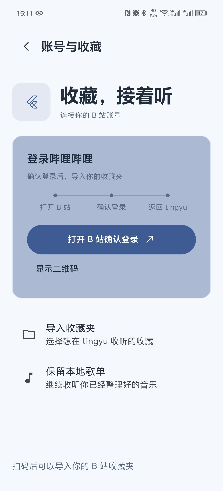
    </td>
  </tr>
  <tr>
    <td align="center" width="50%">
      <h4>3. 设置</h4>
      
切换主题与玻璃透明度，调整默认倍速、定时关闭、音质和存储选项。

      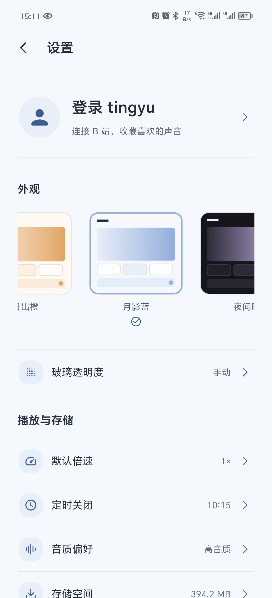
    </td>
    <td align="center" width="50%">
      <h4>4. 搜索 · 听点新鲜的</h4>
      
通过歌曲、UP 主、BV / AV 号或链接查找内容，也可浏览主题推荐。

      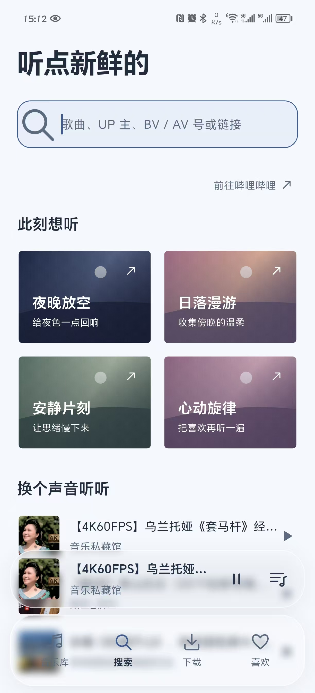
    </td>
  </tr>
  <tr>
    <td align="center" width="50%">
      <h4>5. 歌曲操作菜单</h4>
      
调整音量、安排下一首、加入队列或歌单，管理喜欢与下载，并在 B 站打开。

      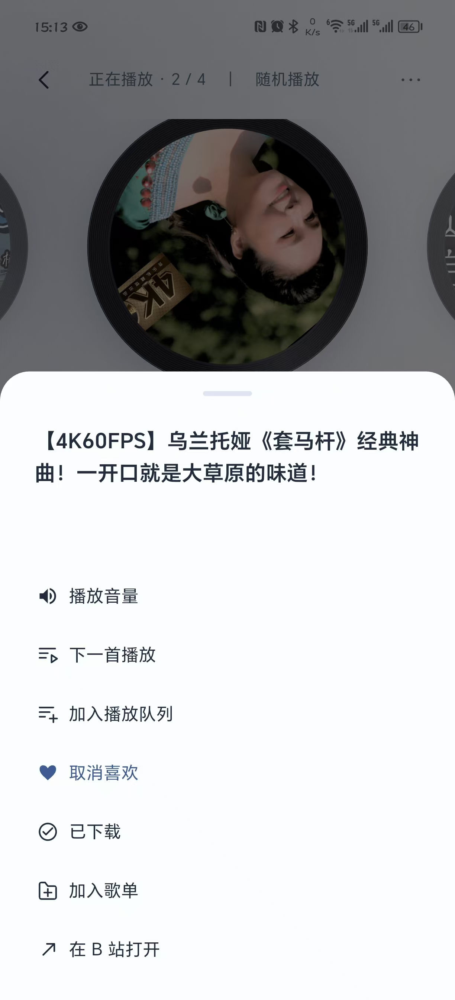
    </td>
    <td align="center" width="50%">
      <h4>6. 歌曲详情 · 播放器</h4>
      
唱片与同步歌词同屏展示，支持进度、倍速、定时、播放模式及队列控制。

      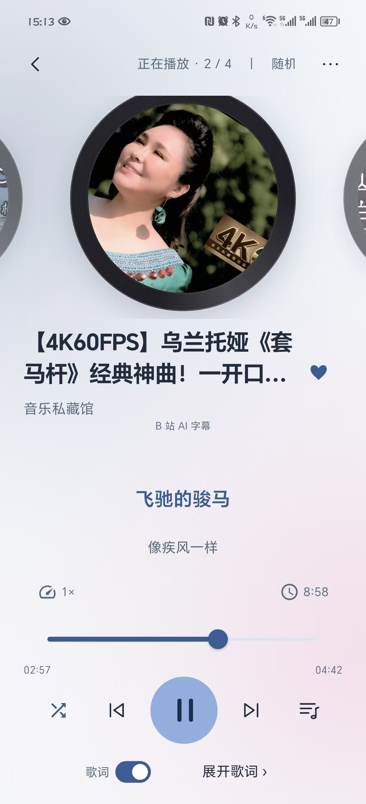
    </td>
  </tr>
  <tr>
    <td align="center" width="50%">
      <h4>7. 喜欢 · 心动收藏</h4>
      
集中收听喜欢的歌曲，支持列表内搜索、排序、多选，并显示下载状态。

      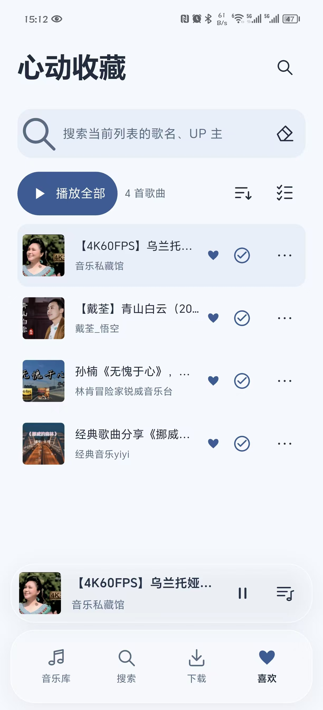
    </td>
    <td align="center" width="50%">
      <h4>8. 下载 · 离线随行</h4>
      
查看已下载歌曲、数量与占用空间，切换下载任务，管理离线音乐。

      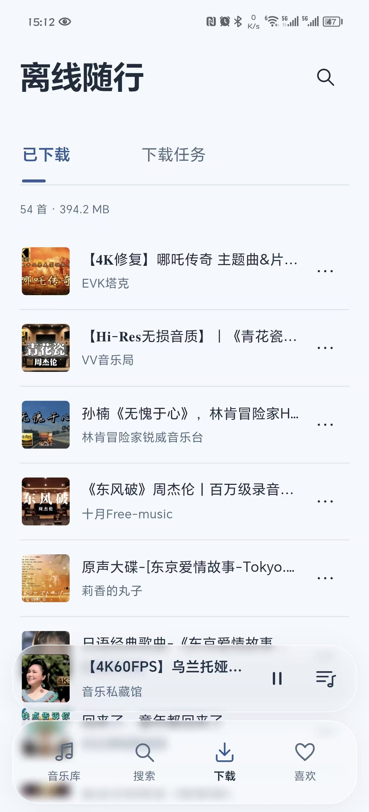
    </td>
  </tr>
</table>

**0.1.28 更新**：Mac 与安卓新增默认开启的自动播放缓存，缓存上限 2 GB，下载可复用匹配音质的缓存；存储页统一清理入口，两态均为方框复选框。修复慢启动可能覆盖本地播放记录的问题，并完善 Mac 定时、搜索、错误提示和歌单操作。

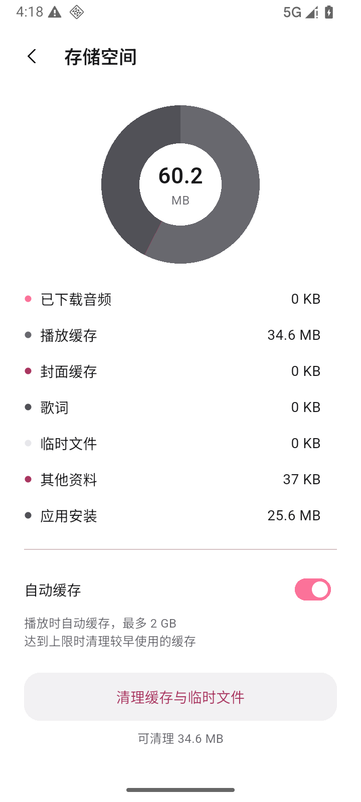 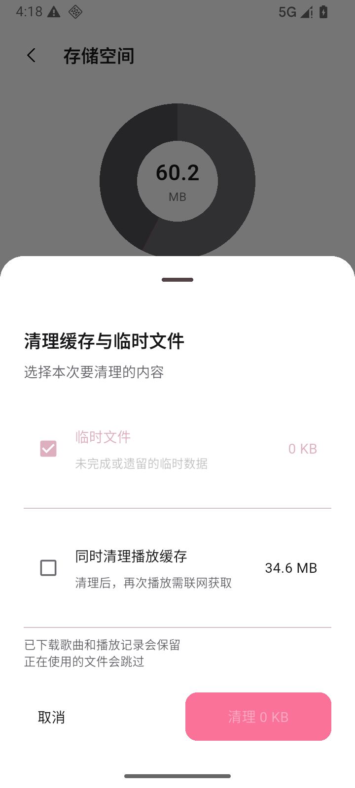

以上新增 Android 截图来自最终 Release APK、隔离模拟器与公开 BV 音频，Mac 截图来自组件夹具；完整缓存不等于永久下载，清理缓存不会删除下载与播放记录。

**0.1.27 更新**：新增 Mac 桌面开发版与两端批量移除；Mac 最近播放采用大封面网格，统一侧栏交互、账号头像、歌词与待播操作弹窗，修复音量面板和存储圆环布局。

**0.1.26 修复**：重启记住播放音量和“播完暂停”偏好；定时关闭时修改该偏好也有效。倒计时不跨重启恢复。本版没有视觉改动，以下截图沿用旧版。

**0.1.25 修复**：歌词切到中间句或末句时，不再推动外层播放页，保持唱片位置稳定。

  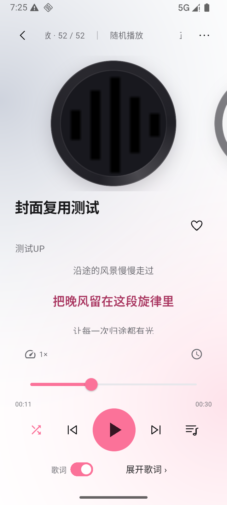
  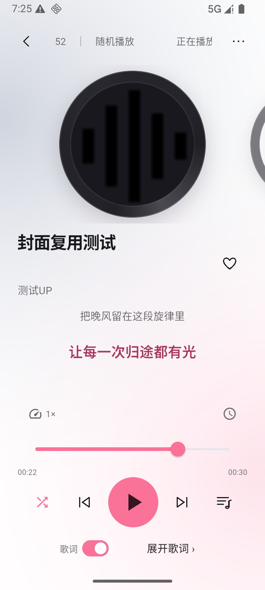

以上两图为 0.1.25 隔离 Android 模拟器的本地夹具运行截图，用于复核歌词切句前后唱片位置。

**0.1.24 更新**：点击“我的歌单”标题即可进入带封面的全部歌单列表；透明度调节与底栏预览分区，拖动时完整露出播放栏和导航栏。

  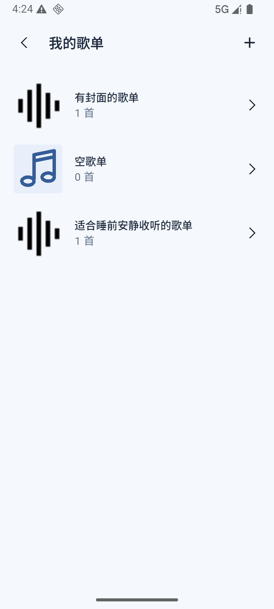
  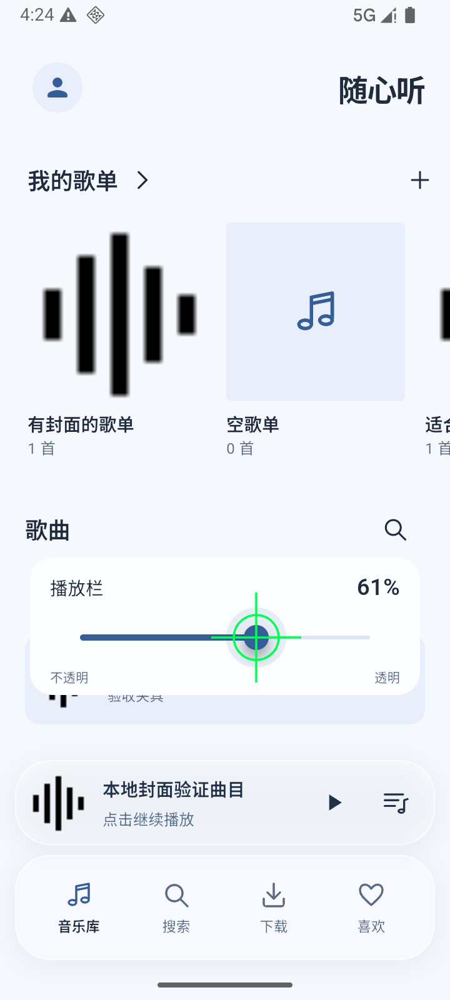

以上更新截图来自隔离 Android 模拟器，使用本地验收夹具。

### macOS

提供未公证的 Mac 开发版：侧栏资料库、大封面最近播放、歌曲详情歌词、核心播放栏与独立待播。构建与验证边界见 [桌面开发说明](docs/DESKTOP.md)。

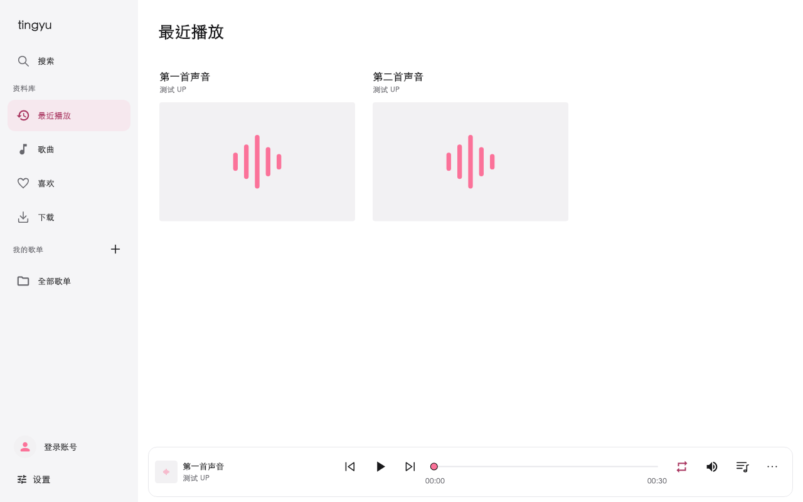

以上为 0.1.27 Mac Flutter 组件夹具截图；真实账号与设备验证边界见版本验收记录。

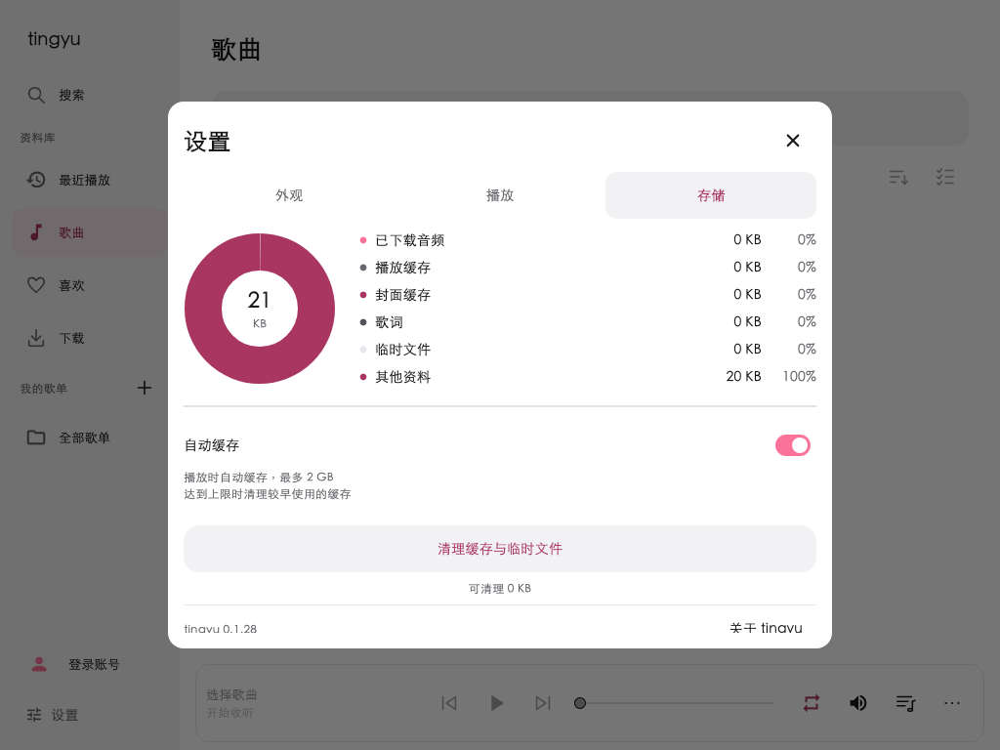

### Windows

## 下载与安装

当前发布版本为 **0.1.28**。前往 [Releases](https://github.com/boyl/tingyu/releases/latest) 查看更新说明。

| 平台 | 下载 |
|---|---|
| Android · arm64-v8a | [下载 APK](https://github.com/boyl/tingyu/releases/download/v0.1.28/tingyu-0.1.28-android-arm64-v8a-release.apk) |
| macOS 12+ · Apple Silicon / Intel（Intel 真机待验） | [下载开发版 DMG](https://github.com/boyl/tingyu/releases/download/v0.1.28/tingyu-0.1.28-macos-release.dmg) |
| Windows | 暂无安装包 |

Android 目前仅提供 arm64-v8a 包，使用开发签名。同签名升级可直接覆盖安装，保留歌单与下载，无需卸载或清空数据。

校验值见 [0.1.28 发布记录](docs/ACCEPTANCE-2026-10-25-028.md)。Mac 使用 ad-hoc 签名，未经过 Apple 公证，系统可能阻止直接打开；本版不等同于商店正式发行。

## 主要功能

- **搜索与收听**：搜索歌曲、粘贴 BV 号或 B 站链接，支持分 P 和后台播放。
- **整理音乐**：带封面的全部歌单列表、本地歌单、喜欢、播放队列、排序与多选；支持打开 B 站确认登录与二维码备用；登录后可导入收藏夹。
- **离线播放**：下载音频及可用的封面、歌词，支持导出 M4A。
- **自动缓存**：默认开启，最多 2 GB，优先淘汰较早使用的缓存；关闭后保留已有缓存。下载复用匹配音质的完整缓存或同一活动传输，缓存与下载分开保存。
- **歌词**：同步逐句／逐字歌词、翻译与罗马音，可手动匹配、编辑和调整偏移；以歌词源实际提供的内容为准。
- **播放控制**：循环、随机、播完暂停、倍速、音量与定时关闭；自定义时长滚轮带刻度反馈；音量和定时结束方式跨重启保留。
- **外观**：哔哩粉、日出橙、月影蓝与夜间暗四种主题。

## 常见问题

**需要登录吗？** 公开 BV 内容可先尝试匿名播放；收藏夹等账号内容需要登录。搜索、播放与授权也受 B 站接口和风控影响。

**数据保存在哪里？** 歌单、喜欢和下载保存在本机，登录凭据使用系统安全存储。当前不提供跨设备同步。

**为什么下载没有继续？** 应用进程被系统结束后，下载不会继续。中断任务可重试，目前不支持 HTTP Range 断点续传。

**哪些平台可以使用？** 提供 Android arm64-v8a 安装包与 Mac 开发版。Windows 尚未发布，模拟器测试不能替代物理设备验收。

## 开发与文档

项目使用 Flutter / Dart，无自建后端。开发环境、架构与检查命令见[开发指南](docs/DEVELOPMENT.md)。

[功能清单](docs/FEATURES.md) · [界面规范](docs/UI.md) · [验收标准](docs/ACCEPTANCE.md) · [发布准则](docs/RELEASE.md) · [版本记录](https://github.com/boyl/tingyu/releases)

0.1.28 的变更与验证边界见[验收记录](docs/ACCEPTANCE-2026-10-25-028.md)。真实账号授权与重启登录保持仍待验。

## 许可

项目采用 [MIT License](LICENSE)。第三方组件和资源遵循各自许可。

Mac 本地开发版已取消独立主页，默认进入最近播放或歌曲列表；最新界面预览见 [Mac 最近播放截图](docs/screenshots/2026-10-24-macos/1280-recent.png)。图库为隔离夹具下的 Flutter 组件截图，原生窗口与真实音频需单独验收。

Mac 与 Android 已增加资料库批量删除、批量取消喜欢和批量移除下载；歌单批量移出改为多选工具栏直接操作。所有删除均先确认范围，资料库删除保留下载文件。
